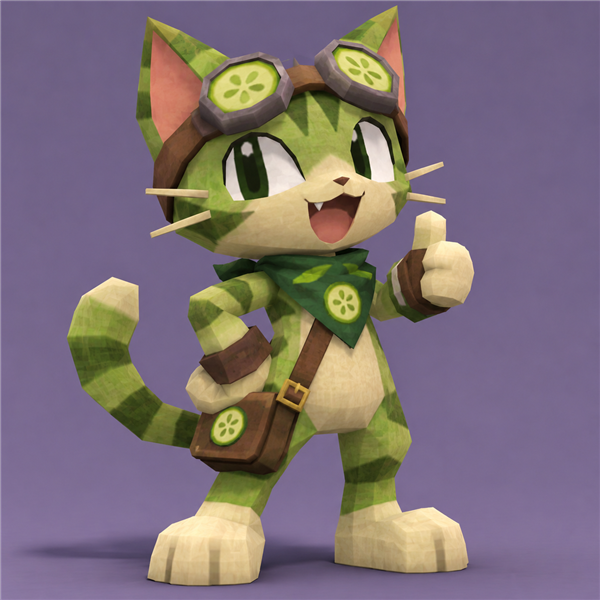

# Cucumber Panic

There is a cat.



There's even more to it.

## What falls

Things fall. Not all of them are good.

| Thing | What happens |
| --- | --- |
| Fish | +1. Just the start. |
| Tuna can | +5. Even more. |
| Cucumber | A life is gone. |
| Spray bottle | Another one gone. |

Nine lives. Then there are none.

## The cat

He is a cucumber. He fears the cucumber.

He does not know.

## How to move

- Arrow keys. Or `A` and `D`.
- The mouse works too. Even a finger.
- `Space`, `Enter` or a click. Then it begins.

It gets faster. Just wait.

## How to run it

Nothing to install.

1. Download or clone the repo.
2. Open `index.html`.

That's all. Even then there's more.

## The end

Every run ends. You get a rank.

Some lose a fight with a salad. Some become more.

The best score stays in your browser.

## What's inside

```
cucumber-panic/
  index.html   the page
  style.css    the colors
  game.js      all of it
  assets/      the cat lives here
```

Plain HTML, CSS and JavaScript. No more than that.

## The code

It's all in `game.js`. There are comments.

- **Settings** at the top. The numbers can change.
- **Funny text** below that. The words can change too.
- **Input.** Keys, mouse, touch.
- **Update.** Things move. Things collide.
- **Draw.** Then you see it.
- **Main loop.** Again and again.

## There's more to change

- New lines in `FISH_LINES`, `CUCUMBER_LINES` or `RANKS`.
- `START_LIVES` from 9 to 1. For the brave.
- A new thing in `ITEM_TYPES`. Then draw it in `drawItem`.
- A new cat. Replace `assets/mascot.png`.

## Who
You might want to follow me. [@ChainChomp131](https://x.com/ChainChomp131)

There's even more to be seen.
